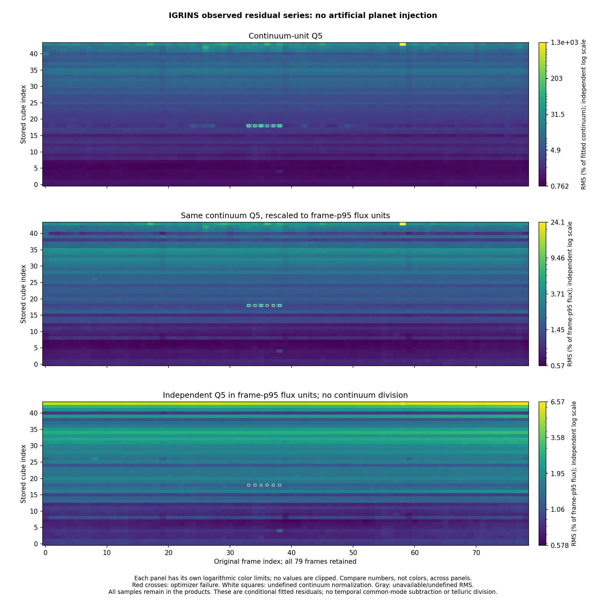

# exojax-telfit

Experimental telluric fitting with ExoJAX, developed on the WASP-77Ab IGRINS
time series. The reference workflow fits **Order 7**, including strong absorption,
with a layered terrestrial atmosphere, PHOENIX plus a blasé stellar correction,
and regularized HITRAN line-strength corrections.
The same fitting procedure can be applied independently to all 44 released
orders, followed by a separate 79-frame export for CCF analysis.

This repository contains the implementation and earlier diagnostic experiments.
Observations, line lists, model checkpoints, numerical results, and **enuma data
are not included**. The original ExoJAX repository and its local IGRINS products
are unchanged by this export. A diagnostic RMS overview is included below.

## Setup

The reference environment used Python 3.12 on Linux with CPU JAX in 64-bit mode.
Install the recorded ExoJAX source revision and the small convolution fix used by
the fitting runs:

```bash
python3.12 -m venv .venv
source .venv/bin/activate
python -m pip install --upgrade pip
mkdir -p _deps
git clone https://github.com/HajimeKawahara/exojax.git _deps/exojax
git -C _deps/exojax checkout 19fe37b5509d931e6fb85bcd731be60877751544
git -C _deps/exojax apply ../../patches/exojax-convolution.patch
python -m pip install -r requirements.txt -e ./_deps/exojax
export JAX_ENABLE_X64=true
export JAX_PLATFORMS=cpu
export OPENBLAS_NUM_THREADS=4
export OMP_NUM_THREADS=4
export MPLCONFIGDIR=/tmp/igrins-matplotlib
```

The patch preserves the requested FFT length and the exact output length of
`convolve_same`, including odd FFT lengths and one-element kernels. It is
distributed separately rather than copying the ExoJAX source tree.

## Current Order 7 workflow

Run commands from this repository's root. Inputs and outputs stay under
`IGRINS/data`, `IGRINS/cache`, and `IGRINS/results`, all ignored by Git.

```bash
python IGRINS/prepare_data.py
python IGRINS/prepare_hitran.py
python IGRINS/prepare_stellar.py
python IGRINS/prepare_atmosphere.py
python IGRINS/prepare_order7_scope.py

python IGRINS/run_order7.py
python IGRINS/fit_order7_stellar.py --strength-solver lbfgsb --null-refits 8
python IGRINS/diagnose_order7_species.py
python IGRINS/check_order7.py
python IGRINS/report_order7.py
python IGRINS/activate_order7.py
```

See [data preparation](docs/DATA.md) for source URLs, checksums, reference
atmospheric assumptions, and download limitations. The HITRAN endpoint is live:
preserve the downloaded files and their metadata when comparing exact results.
The dense opacity and line-response calculations can require substantial RAM.

The first stellar-clone preparation has a bounded evaluation budget. If it stops
with a message that the PHOENIX clone has not converged, rerun the same stellar-fit
command: the clone checkpoint is retained and used as the starting point.
For an interrupted observational fit with a saved checkpoint, add `--resume`.
`--polish` also requires `--resume` and an existing stellar/telluric checkpoint.

The initializer in `config/order7_initial.json` preserves the earlier physical
starting values, including the fixed stellar velocity and extra broadening.
Historical fitted arrays are not required to start this workflow. Earlier
coarse/tight solver-control tables appear in the report only when their local
control files exist; they are not fabricated for a new run.

## All orders and the observed CCF series

After preparing the same inputs, run:

```bash
python IGRINS/run_all_orders.py --jobs 8 --cpus-per-job 8 \
  --degree-four-continuum-orders $(seq 19 35) \
  --degree-five-continuum-orders $(seq 36 42) \
  --all-pixel-continuum-orders 43
python IGRINS/summarize_all_orders.py --combine --png
python IGRINS/run_ccf_series.py --jobs 2 --cpus-per-job 8
python IGRINS/summarize_ccf_series.py
```

Choose CPU allocations that fit the machine. The shared fit uses the five
training frames and four comparison frames listed below. Existing complete
products are reused, including the frozen Order 7 reference when available.
The all-order report preserves missing or failed orders explicitly. It combines
the nine-frame products only when all 44 pass its checks.

Some full-order blaze shapes require explicit continuum exceptions. Cube
indices 19–35 use degree four, and 36–42 use degree five. Index 43 retains a
cubic but profiles it on all pixels in its comparison frames. The original
cubic profiles crossed zero at faint edges in these orders. The fifth-degree
choice for indices 36–38 also improves independent score-block residuals over
the positive but inadequate fourth-degree profiles. The report records
the actual degree, scope and minimum continuum. These smooth-component changes
do not repair the low throughput or guarantee small normalized residuals.

The CCF application preserves the original fiducial stage ordering. It fits
each new frame's water scaling, wavelength offset, IP width and continuum
against the frozen, uncorrected physical model. It then applies the frozen
stellar and line-strength corrections and the degree-five residual projection,
keeping that continuum fixed. New frames follow the original held-out
calibration rules and each order's adopted continuum degree/scope. The known
nine frames reuse their saved nuisance parameters and continuum, with an exact
conversion between physical and exported flux normalization. Their model and
residual arrays are checked against the saved benchmark.

The CCF product contains the **original observations with no artificial planet
injection**, residuals before and after degree-five smooth subtraction,
stellar/telluric/full model components, original BJD/phase metadata and validity
flags. Fitted wavelength sampling offsets, stretch and per-frame IP parameters
are included for downstream template evaluation; they do not constitute an
independently verified absolute or barycentric wavelength solution.
No temporal mean or common residual template is subtracted, and no
telluric division is applied. Flux residuals are stored as fractions, not
percentages. Wavelength decreases along the last axis; wavenumber increases.
Order coordinates are zero-based cube indices; only cube index 5 has the
confirmed user label Order 7.

`IGRINS/results/allorders_ccf_no_injection.npz` is the final combined array file.
Its generated README describes the fields and quality flags. Very faint
continua can amplify continuum-normalized noise; use
`residual_fixed_scale_q5_independent` to apply the smooth subtraction directly
in units of each frame's p95 observed flux without continuum division.
Undefined normalization and unsuccessful fits remain
flagged in the output. A complete export is not an injection-recovery test.
Optimizer termination also differs from strict repeated-refit stabilization:
the recorded all-order run passed the optimizer checks but did not meet that
stricter threshold. Per-order flags are in `allorders_summary.json`.



The 44-order, 79-frame overview compares continuum-normalized Q5 residuals,
the same projection rescaled to frame-p95 units, and Q5 applied independently
in frame-p95 units. Each panel has its own logarithmic color scale; their colors
are not directly comparable. White squares mark frames with undefined
continuum normalization. No artificial planet signal was injected.

`run_ccf_series.py --wait-for-fits 21600` can consume shared products as they
become available. Allocate separate CPU sets with `taskset` when running it
alongside the shared-fit batch. Intermediate products and all input data remain
Git-ignored under `IGRINS/`.

## Model and evaluation

- **Band:** 2.26622167–2.29458395 microns in the released archive, all 1,848 pixels.
  User Order 7 corresponds to released cube row 5, identified by wavelength.
- **Shared training frames:** 0, 19, 39, 59, 78. Comparison frames: 10, 30, 50, 70.
  Frame indices are zero-based. Evaluation-frame nuisance parameters and smooth
  residual terms are fitted conditionally; this is not a fully untouched holdout.
- **Atmosphere:** dated 20-layer T-P/H2O profile with H2O, CH4, N2O, CO, and CO2,
  pressure shifts, and a symmetric two-Gaussian instrumental profile.
- **Star:** PHOENIX anchored to a real blasé clone. Selected feature amplitudes
  vary; stellar centers, widths, and reference kinematics remain fixed.
- **Telluric strengths:** nonnegative, shared corrections with HITRAN uncertainty
  categories and a prior that suppresses unnecessary changes to weak lines.
- **Smooth residual:** a degree-five polynomial per frame on the full order.
  No time-common residual template is subtracted.
- **Optimization:** bounded TRF least squares for physical and stellar parameters;
  L-BFGS-B for the final large telluric-strength fit, using JAX derivatives.
  The continuum and polynomial terms use linear least squares.

The reference all-pixel RMS was **0.820934%** of the original fitted continuum.
See [reference results and limitations](docs/REFERENCE_RESULTS.md). The strict
repeated-refit threshold was not met in that reference run, and planet-injection
recovery has not been validated for this expanded Order 7 region. This export
does not establish a validated telluric-removal pipeline for planetary spectroscopy.

## Diagnostics and optional comparison

```bash
python IGRINS/diagnose_order7_4383_profile.py
python IGRINS/diagnose_order7_4383_telluric.py
```

These local experiments diagnose overlapping stellar and CH4 absorption; they
do not replace the active fit. Earlier scripts for pressure broadening, line
shifts, T-P freedom, IP alternatives, weak-line priors, spectral masks,
signal-injection checks, and TransformerPayne are retained alongside the current
workflow. Most historical scripts expect the corresponding earlier products and
are not independent fresh-checkout entry points. Their old-order validation
results must not be transferred to Order 7.

`overlay_enuma.py` remains an optional reader for a separately supplied local
`IGRINS/series_model.npz`. Its keys are `frame`, `wave`, `flux_model`, and
`flux_telluric`. The report adds that overlay only when the file exists. The
reader documents its inferred flux normalization and optional smooth blaze
adjustment. **Neither the enuma input nor its derived comparison arrays or plots
are distributed here.**

## Checks and provenance

```bash
python -m pip install -r requirements-dev.txt
python -m pytest
python -m compileall -q IGRINS
```

The lightweight regression checks exercise the required ExoJAX convolution
behavior and the guarded TRF SVD fallback. `check_order7.py` independently
verifies fitted products after a real fit. Initial-export source hashes and
the environment are recorded in
`docs/implementation_manifest.json`.

The implementation is MIT licensed. The vendored blasé JAX module retains its
own [MIT license](IGRINS/vendor/blase/LICENSE) and
[upstream provenance](IGRINS/vendor/blase/PROVENANCE.json). External observations,
line lists, and stellar models retain their respective source terms.
